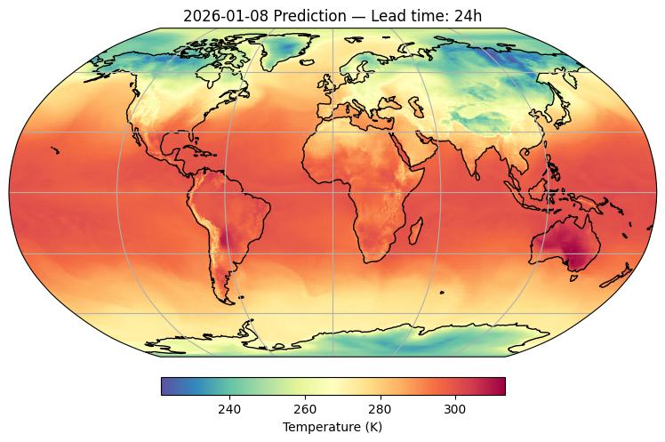
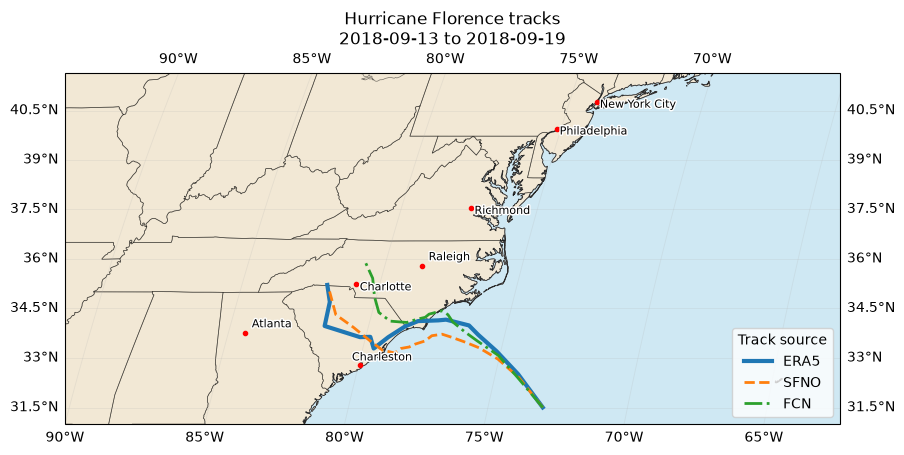

# Earth2Studio: AI Weather Forecasting Tutorial



Video walkthrough: https://www.youtube.com/watch?v=pEDuD49dReM

AI weather forecasting with [NVIDIA Earth2Studio](https://github.com/NVIDIA/earth2studio), in four sections that follow the video: a 2 m temperature forecast with FCN, a 10 m wind speed and sea level pressure forecast with SFNO, a Hurricane Florence track comparison (SFNO, FCN and ERA5), and a 14-day Aurora forecast of 500 hPa geopotential height. The plots are regenerated with Earth2Studio 0.20.0 and may differ slightly from the video.

## Results at a glance

These figures are produced by the notebook. Forecast skill is not scored here; see the Hurricane-Forecasts and Flood-Forecasts repositories for verification against ERA5.


*SFNO 10 m wind speed over North America and the North Atlantic.*



*Hurricane Florence: SFNO and FCN forecast tracks against the ERA5 reference track.*


*Aurora 500 hPa geopotential height on the last day of the 14-day forecast.*

## Models and data

| Model or data | Developer | Initial condition | Notebook section |
|---|---|---|---|
| FCN (FourCastNet) | NVIDIA | GFS (section 1), NCAR ERA5 (section 3) | 1, 3 |
| SFNO (Spherical Fourier Neural Operator) | NVIDIA | GFS (section 2), ARCO ERA5 (section 3) | 2, 3 |
| Aurora | Microsoft | GFS | 4 |
| ERA5 (WeatherBench2 copy) | ECMWF reanalysis | — | 3 (reference track) |
| GFS | NOAA | — | 1, 2, 4 |

In section 3 the Wu–Duan tracker (`TCTrackerWuDuan` in Earth2Studio) extracts the storm path from each forecast and from ERA5.

## Quick start

Requires Python 3.12, [uv](https://docs.astral.sh/uv/), and an NVIDIA GPU with 46 GB+ of VRAM.

```bash
git clone https://github.com/ChristianByars/Earth2.git
cd Earth2
uv sync
uv run python -m ipykernel install --user --name earth2 --display-name "earth2"
```

`uv sync` expects two prebuilt wheels (flash-attn and torch-harmonics) in a `wheels/` folder; see [docs/environment.md](docs/environment.md).

Open `Earth2.ipynb` in JupyterLab and select the **earth2** kernel, then run all cells.

## Running on the SDSU Nautilus cluster

The tutorial was developed on a single L40 GPU on the SDSU SCIL Nautilus cluster. [docs/kubernetes.md](docs/kubernetes.md) explains how to create the volume and the JupyterLab pod from `jupyter-volume.yaml` and `jupyter-pod-L40.yaml`, connect to JupyterLab and shut the pod down. Inside the JupyterLab terminal, install `curl` and `uv` first, then follow the Quick start above:

```bash
sudo apt-get update && sudo apt-get install -y curl
curl -LsSf https://astral.sh/uv/install.sh | sh
```

## Notebooks

<!-- RUNS:START -->
_Runtime and GPU memory are filled in after the verified run._
<!-- RUNS:END -->

| Notebook | What it covers |
|---|---|
| `Earth2.ipynb` | Four sections in the order of the video: FCN 2 m temperature, SFNO 10 m wind speed and mean sea level pressure, Hurricane Florence track comparison (SFNO, FCN, ERA5), and the Aurora 14-day 500 hPa height forecast with an animated GIF. |

## Repository layout

```text
Earth2/
├── Earth2.ipynb          # the tutorial notebook
├── main.py               # placeholder entry point from the uv project template
├── jupyter-pod-L40.yaml  # Kubernetes pod template (SDSU Nautilus, one L40 GPU)
├── jupyter-volume.yaml   # Kubernetes persistent volume template
├── pyproject.toml        # dependencies (earth2studio 0.20.0, torch 2.13.0)
├── uv.lock               # exact resolved versions
└── docs/
    ├── environment.md    # pinned stack, install notes and fixes
    ├── kubernetes.md     # running on the SDSU Nautilus cluster
    └── images/           # figures embedded in this README
```

The notebook writes its forecasts and figures to git-ignored folders (`t2m_outputs/`, `sfno_outputs/`, `florence_outputs/`, `aurora_outputs/`).

## Environment notes

Pinned versions, install caveats, and fixes are in [docs/environment.md](docs/environment.md).

## References

- [NVIDIA Earth2Studio](https://github.com/NVIDIA/earth2studio)
- [Earth2Studio Docs](https://nvidia.github.io/earth2studio/)
- [uv](https://docs.astral.sh/uv/)
- YouTube video link to my tutorial: https://www.youtube.com/watch?v=pEDuD49dReM
